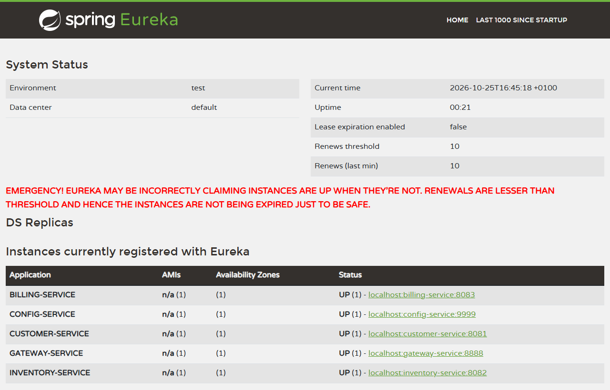
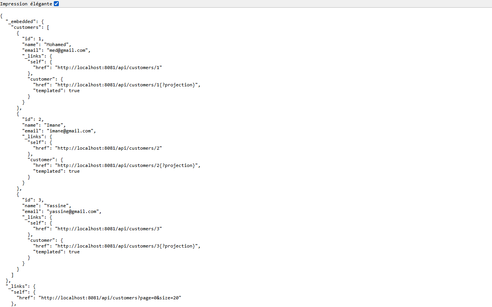
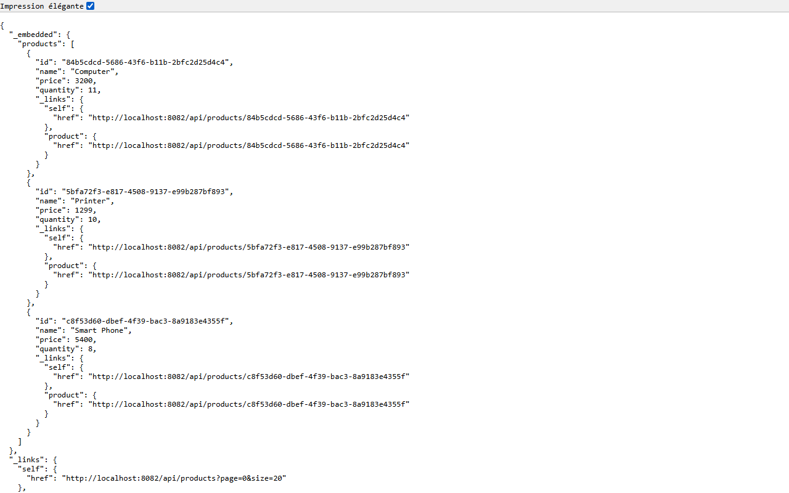
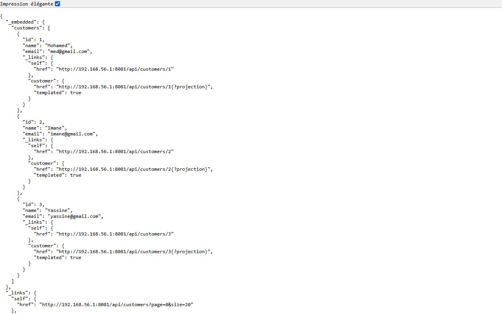
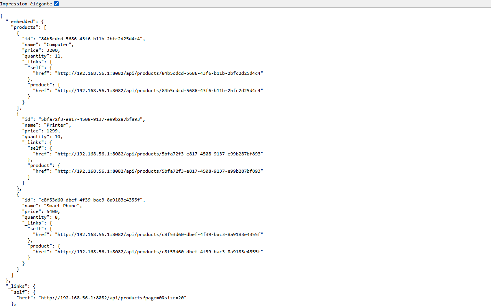
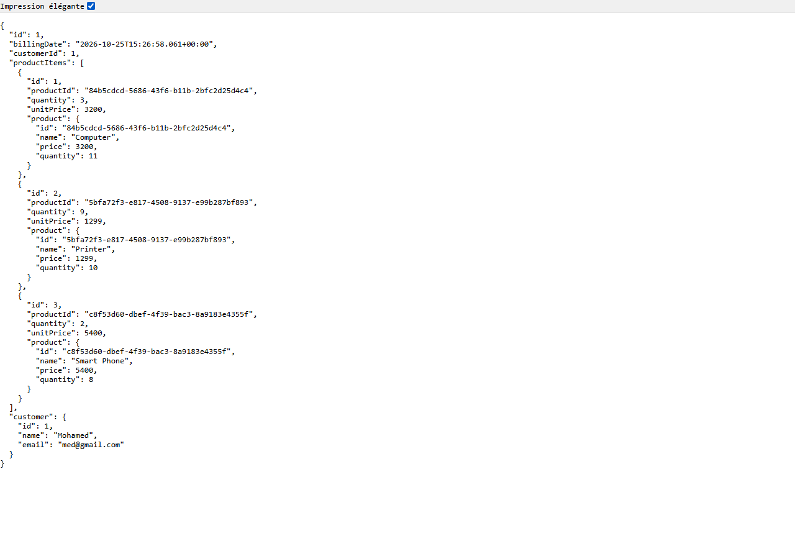
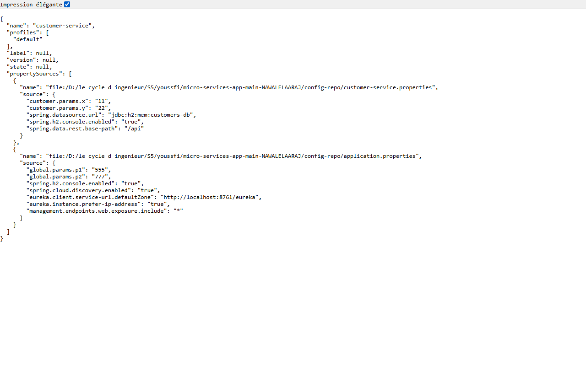
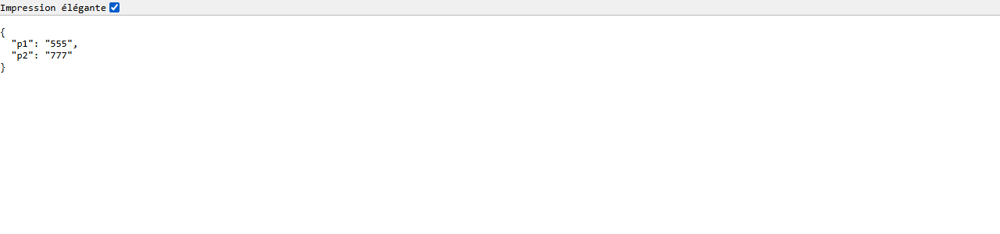
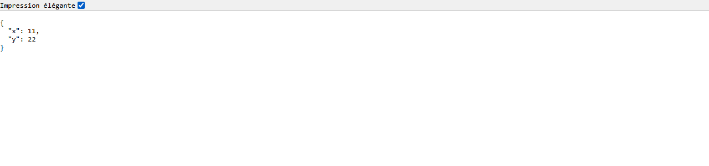
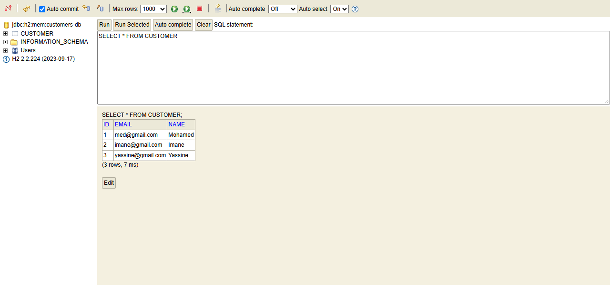

# Architecture Micro-services avec Spring Cloud

Application e-commerce simple découpée en micro-services avec **Spring Boot 3.3.5**, **Spring Cloud 2023.0.3** et **Java 21**.

## Architecture

```
                 ┌──────────────────────┐
   Client ─────▶ │  gateway-service     │ :8888
                 └──────────┬───────────┘
                            │ (routage via Eureka)
        ┌───────────────────┼────────────────────┐
        ▼                   ▼                    ▼
 customer-service    inventory-service     billing-service
      :8081               :8082                 :8083
        ▲                   ▲                    │
        └───── OpenFeign ───┴────────────────────┘

 discovery-service (Eureka) :8761   config-service (Config Server) :9999
```

| Service             | Port | Rôle |
|---------------------|------|------|
| `discovery-service` | 8761 | Annuaire Eureka : enregistrement et découverte des services |
| `config-service`    | 9999 | Spring Cloud Config Server : configuration centralisée (Git) |
| `gatewey-service`   | 8888 | Spring Cloud Gateway : point d'entrée unique, routes dynamiques via Eureka |
| `customer-service`  | 8081 | Gestion des clients (`Customer` : id, name, email) – Spring Data REST + H2 |
| `inventory-service` | 8082 | Gestion des produits (`Product` : id, name, price, quantity) – Spring Data REST + H2 |
| `billing-service`   | 8083 | Factures (`Bill`, `ProductItem`) ; récupère clients et produits via OpenFeign |

## Configuration centralisée

Le dossier [`config-repo/`](config-repo) contient les fichiers de configuration servis par le `config-service` :

- `application.properties` : paramètres communs (Eureka, H2 console, actuator, `global.params.*`)
- `<service>.properties`, `<service>-dev.properties`, `<service>-prod.properties` : configuration par service et par profil

Le `customer-service` expose deux endpoints pour tester la configuration (rechargeable avec `@RefreshScope` / `actuator/refresh`) :

- `GET /testConfig1` → `global.params.p1`, `global.params.p2`
- `GET /testConfig2` → `customer.params.x`, `customer.params.y`

## Lancement

Démarrer les services dans cet ordre (depuis chaque dossier, `./mvnw spring-boot:run` ou depuis l'IDE) :

1. `discovery-service`
2. `config-service`
3. `customer-service`, `inventory-service`
4. `billing-service`
5. `gatewey-service`

Tableau de bord Eureka : <http://localhost:8761>

## Endpoints principaux

Directement :

- Clients : <http://localhost:8081/api/customers>
- Produits : <http://localhost:8082/api/products>
- Facture complète (client + produits) : <http://localhost:8083/bills/1>

Via la gateway (nom du service en minuscules) :

- <http://localhost:8888/customer-service/api/customers>
- <http://localhost:8888/inventory-service/api/products>
- <http://localhost:8888/billing-service/bills/1>

Console H2 : `/h2-console` sur chaque service métier.

## Captures d'écran

### Tableau de bord Eureka

Les cinq services (`billing`, `config`, `customer`, `gateway`, `inventory`) sont enregistrés et `UP`.



### Customer service – `GET /api/customers`



### Inventory service – `GET /api/products`



### Billing service – `GET /bills/1`

Facture complète : le client et les produits sont récupérés via OpenFeign.


### Accès via la gateway

`GET /customer-service/api/customers`



`GET /inventory-service/api/products`



`GET /billing-service/bills/1`



### Config Server – `GET /customer-service/default`



### Test de la configuration – `/testConfig1` et `/testConfig2`





### Console H2 du customer-service



## Technologies

Spring Boot · Spring Cloud Gateway · Netflix Eureka · Spring Cloud Config · OpenFeign · Spring Data JPA / REST · H2 · Lombok · Maven
